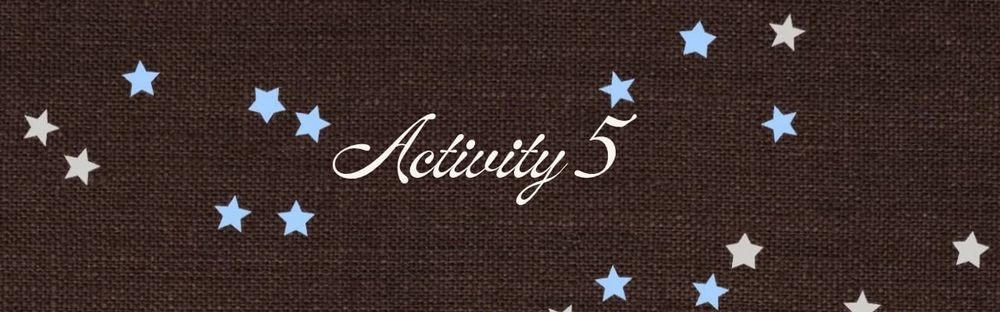
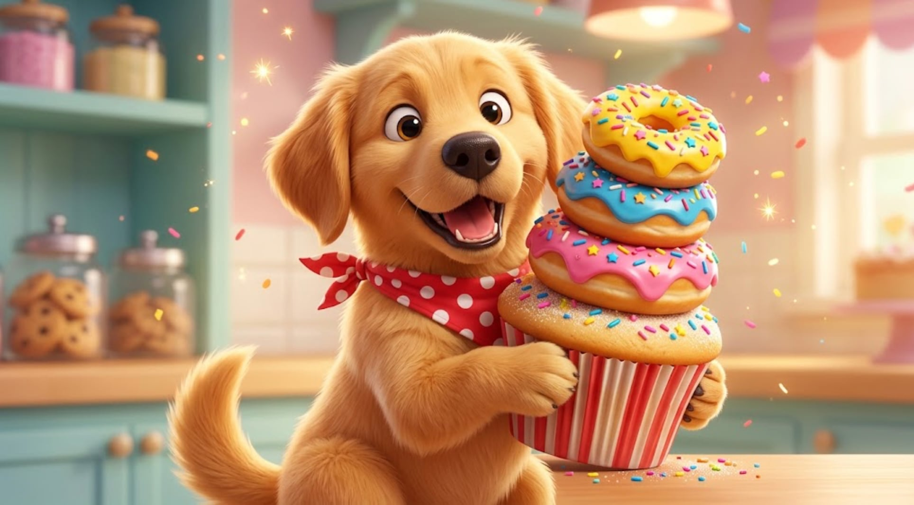
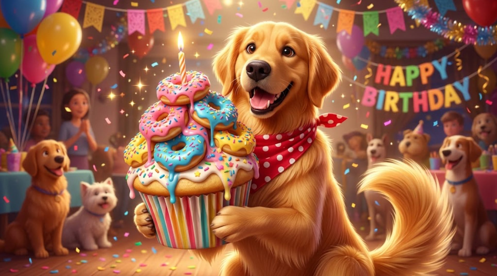
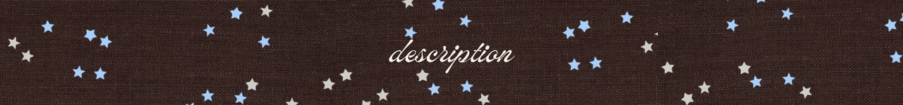

  

  

     
  

  

  <h2>
    𝑨𝑰 𝑰𝒎𝒂𝒈𝒆 𝑮𝒆𝒏𝒆𝒓𝒂𝒕𝒊𝒐𝒏 𝒂𝒏𝒅 𝑷𝒓𝒐𝒎𝒑𝒕 𝑬𝒏𝒈𝒊𝒏𝒆𝒆𝒓𝒊𝒏𝒈
  </h2>

For this activity, I explored the use of Gemini 3.1 Pro in generating creative digital illustrations through artificial intelligence. I chose to create a cartoon-style illustration of a golden retriever holding a vanilla cupcake topped with colorful, rainbow-sprinkled donuts. I wanted to experiment with how AI interprets creative instructions and how changing the details of a prompt can influence the final image.

The activity involved generating two images using different versions of the same idea. The first image was created using a simple prompt that provided only the main subjects and general appearance. After examining the initial result, I developed a more detailed prompt that specified the dog's appearance, the cupcake design, the arrangement of the donuts, and the overall setting.

Through this process, I was able to compare the two generated images and observe how prompt engineering improves the clarity, detail, and overall visual quality of AI-generated content. The activity demonstrated how specific instructions can help an AI tool produce an output that more closely matches the user's intended concept.

  <h3>
    𝑷𝒓𝒐𝒎𝒑𝒕 𝑬𝒏𝒈𝒊𝒏𝒆𝒆𝒓𝒊𝒏𝒈 𝑨𝒑𝒑𝒓𝒐𝒂𝒄𝒉
  </h3>

In creating the first image, I used a straightforward prompt asking the AI to illustrate a golden retriever holding a cupcake with rainbow-sprinkled donuts as frosting. Although the AI successfully generated the requested subjects, the donuts appeared as separate pastries stacked vertically rather than resembling flowing cupcake frosting.

For the second image, I improved the prompt by providing more specific instructions about the appearance and composition. I described the golden retriever as having long, shiny golden fur and wearing a red polka-dot scarf. I also emphasized that the donuts should resemble flowing frosting instead of being stacked individually. Additionally, I requested a birthday party atmosphere to make the illustration more colorful, lively, and visually engaging.

The refined prompt produced a more elaborate illustration featuring a larger cupcake, colorful icing, a birthday candle, balloons, confetti, and party decorations. These additional details helped establish a clearer theme and made the second image more closely aligned with my intended design.

  <h3>
    𝑪𝒐𝒎𝒑𝒂𝒓𝒊𝒔𝒐𝒏 𝒐𝒇 𝑨𝑰-𝑮𝒆𝒏𝒆𝒓𝒂𝒕𝒆𝒅 𝑰𝒎𝒂𝒈𝒆𝒔
  </h3>

★ **Clarity** – The first prompt communicated the basic concept but allowed the AI to interpret the arrangement of the donuts independently. The improved prompt provided clearer instructions about the subjects, setting, and desired appearance.

★ **Detail** – The first image featured a golden retriever holding a cupcake with neatly stacked donuts against a simple pastel kitchen background. The second image included more detailed fur, colorful decorations, a birthday candle, and a festive environment.

★ **Accuracy** – Both images successfully represented the main idea of a golden retriever holding a cupcake decorated with donuts. However, the second image followed more of the requested visual details, particularly the birthday party setting and the more dynamic arrangement of the frosting, although the donuts still appeared as recognizable pastries.

★ **Usefulness** – The first image demonstrated how AI responds to simple creative instructions, while the second showed how a refined prompt can produce a more personalized and visually expressive result.

  <h3>
    𝑪𝒓𝒆𝒂𝒕𝒊𝒗𝒆 𝑷𝒓𝒐𝒄𝒆𝒔𝒔
  </h3>

During the creative process, I focused on understanding how the wording of a prompt affects the image generated by artificial intelligence. I began with a simple concept and examined how the AI interpreted the different elements, particularly the combination of a cupcake and donuts as frosting.

After reviewing the first result, I identified details that could be improved, such as the arrangement of the donuts, the dog's appearance, and the background setting. I then incorporated these observations into a more descriptive prompt to guide the AI toward my intended illustration. Comparing the two outputs allowed me to see how additional instructions can influence the composition, visual details, and overall atmosphere of an image.

This activity helped me understand the importance of clear communication, creativity, and critical thinking when using AI tools. I learned that producing a successful AI-generated image involves more than simply entering a prompt. It also requires evaluating the initial result, identifying areas for improvement, and refining the instructions to achieve a more accurate and meaningful output. Through this experience, I gained a better appreciation of prompt engineering as a useful skill in digital creativity and artificial intelligence.

 

[📄 **Click here to view PDF →**](EMA_ACTIVTY-5-2.pdf)

