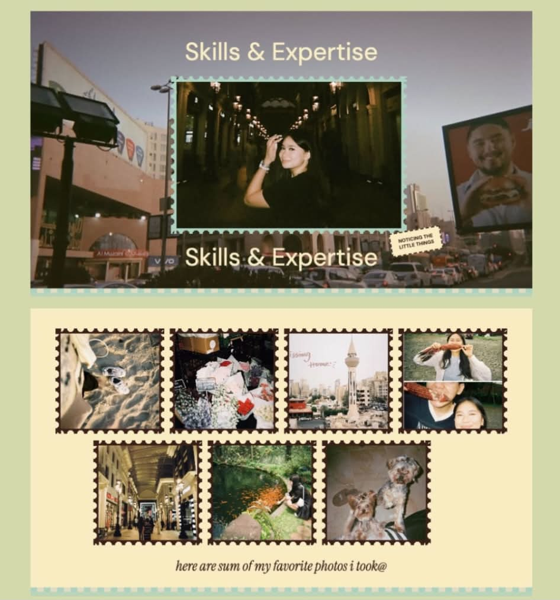
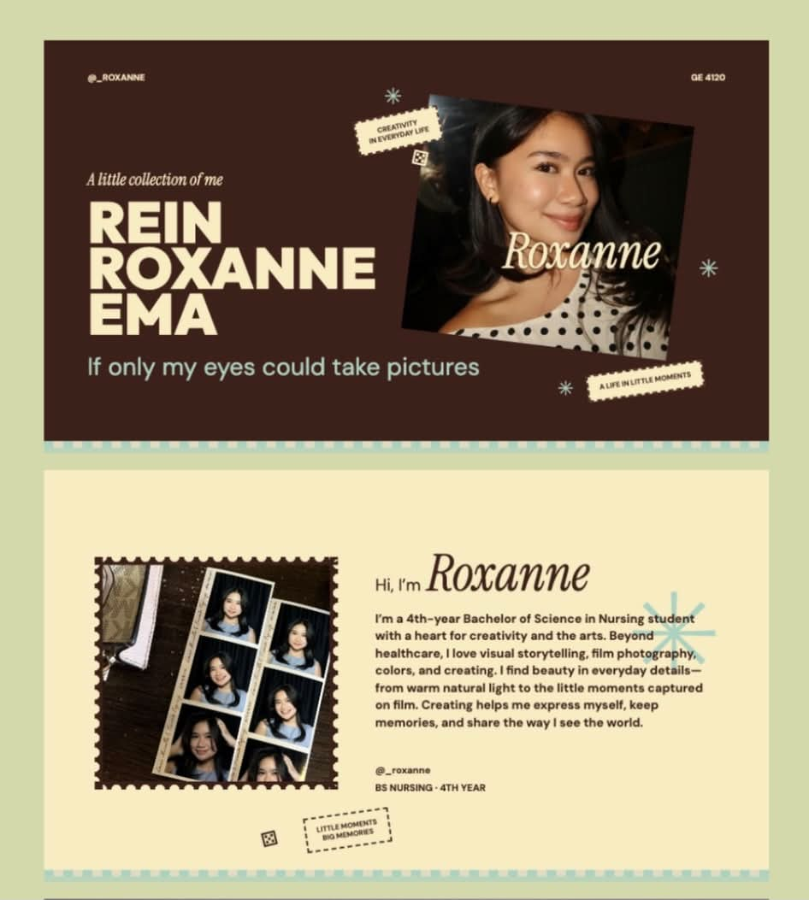
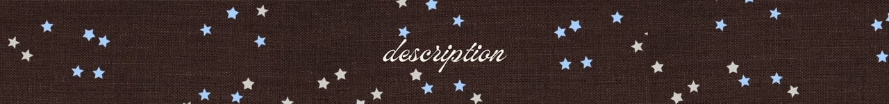

  

  

     
  

  

  <h2>
    𝑷𝒆𝒓𝒔𝒐𝒏𝒂𝒍 𝑷𝒐𝒓𝒕𝒇𝒐𝒍𝒊𝒐 𝑾𝒆𝒃𝒔𝒊𝒕𝒆
  </h2>

For this activity, I created a personal portfolio website that introduces who I am while showcasing my creativity, interests, educational background, and passion for photography. I wanted to design a website that reflects my personality and allows visitors to see a different side of me beyond being a fourth-year nursing student at Ateneo de Davao University.

Through this website, I aimed to create a personal digital space where I could share some of my favorite photographs, introduce my background, and present my skills and interests. Rather than following a traditional professional portfolio layout, I chose a more creative and personalized approach inspired by digital scrapbooks, vintage photographs, and editorial-style designs.

The website combines personal photographs, decorative typography, warm colors, and scrapbook-inspired elements to create a visually engaging experience. This activity allowed me to explore how artificial intelligence and website-building tools can be used to transform creative ideas into a functional digital portfolio.

  <h3>
    𝑾𝒆𝒃𝒔𝒊𝒕𝒆 𝑫𝒆𝒔𝒊𝒈𝒏 𝑨𝒑𝒑𝒓𝒐𝒂𝒄𝒉
  </h3>

In designing my website, I focused on creating a layout that feels personal, creative, and visually organized. I wanted the overall appearance to resemble a collection of memories presented through a digital scrapbook, while maintaining the structure of a personal portfolio.

I organized the website into different sections, beginning with an introductory homepage displaying my name, Rein Roxanne Ema, followed by a personal introduction, my skills and expertise, and a collection of photographs I have taken. Each section was designed to present information about myself while maintaining a consistent visual theme.

For the overall appearance, I used a combination of dark brown, cream, and soft earthy tones to create a warm and vintage-inspired atmosphere. I incorporated decorative borders resembling postage stamps, photo collage arrangements, and a combination of bold and elegant typography. These elements helped make the website feel more like a personal journal or creative scrapbook rather than a conventional academic portfolio.

  <h3>
    𝑫𝒆𝒔𝒊𝒈𝒏 𝑷𝒓𝒊𝒏𝒄𝒊𝒑𝒍𝒆𝒔 𝑨𝒑𝒑𝒍𝒊𝒆𝒅
  </h3>

★ **Visual Hierarchy** – The website begins with a prominent display of my name and personal photograph, followed by sections introducing my background, skills, and photography collection. This arrangement allows visitors to explore the content in a logical sequence.

★ **Contrast** – The combination of dark brown backgrounds, light cream sections, and contrasting typography helps emphasize important information while maintaining a visually appealing appearance.

★ **Balance** – The placement of photographs, text, and decorative elements creates a balanced composition. The use of photo collages and framed images adds personality without making the layout feel overly crowded.

★ **Consistency** – The repeated use of vintage-inspired colors, decorative borders, typography, and scrapbook elements creates a unified design throughout the website.

  <h3>
    𝑾𝒆𝒃𝒔𝒊𝒕𝒆 𝑪𝒐𝒏𝒕𝒆𝒏𝒕 𝒂𝒏𝒅 𝑭𝒆𝒂𝒕𝒖𝒓𝒆𝒔
  </h3>

The website contains several sections that highlight different aspects of my personality, experiences, and interests.

★ **Homepage** – Introduces my name through bold typography and a personal photograph, establishing the overall theme of the website.

★ **About Me** – Presents a short introduction about myself as a fourth-year nursing student while highlighting my interests in photography, creativity, and exploring new experiences.

★ **Skills & Expertise** – Showcases my abilities and interests, providing visitors with a better understanding of what I enjoy doing and the skills I continue to develop.

★ **Photography Collection** – Features a selection of my favorite photographs displayed in decorative postage-stamp-style frames. This section reflects my passion for capturing meaningful moments, places, and experiences through photography.

  <h3>
    𝑪𝒓𝒆𝒂𝒕𝒊𝒗𝒆 𝑷𝒓𝒐𝒄𝒆𝒔𝒔
  </h3>

During the creation process, I focused on transforming my personal interests and design preferences into a website that represents my identity. I began by identifying the information I wanted to include, such as my background, skills, photographs, and personal introduction. I also gathered visual references to guide the overall layout, colors, typography, and decorative elements.

 

[📄 **Click here to view PDF →**](EMA_ACTIVITY-6.pdf)

