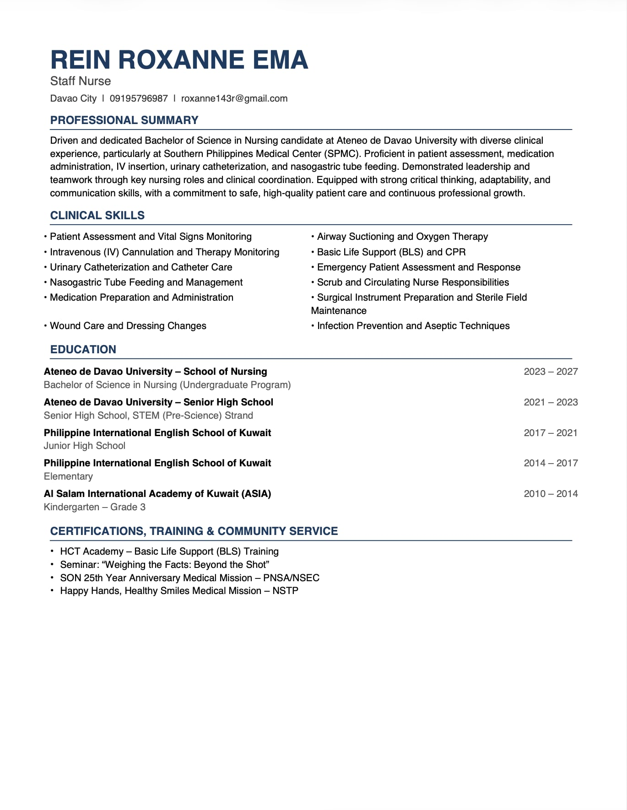
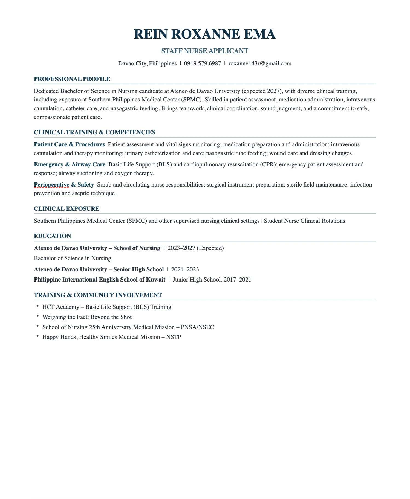

  

  

     
  

  

  <h2>
    𝑨𝑰-𝑮𝒆𝒏𝒆𝒓𝒂𝒕𝒆𝒅 𝑹𝒆𝒔𝒖𝒎𝒆 𝑪𝒐𝒎𝒑𝒂𝒓𝒊𝒔𝒐𝒏
  </h2>

For this activity, I explored the use of artificial intelligence in creating a professional nursing resume by comparing the outputs of two large language models (LLMs), Claude AI and ChatGPT. I wanted to understand how different AI tools interpret the same instructions and how their approaches to organization, formatting, and presentation can affect the quality of a professional document.

The activity involved providing both AI tools with the same prompt requesting a clean, modern, and well-organized resume suitable for an entry-level Staff Nurse position. I included my personal background, nursing education, clinical competencies, relevant training, and certifications to see how each model would organize the information into a professional one-page resume.

Through this activity, I was able to examine the differences between the two outputs and identify which features were more effective for presenting my qualifications as a future nurse. It also helped me appreciate how AI can assist in preparing professional documents while emphasizing the importance of reviewing and improving AI-generated content.

  <h3>
    𝑨𝑰 𝑻𝒐𝒐𝒍𝒔 𝒂𝒏𝒅 𝑷𝒓𝒐𝒎𝒑𝒕𝒊𝒏𝒈 𝑨𝒑𝒑𝒓𝒐𝒂𝒄𝒉
  </h3>

In completing this activity, I used Claude AI as LLM 1 and ChatGPT as LLM 2. Both tools received the same instructions and personal information to ensure that the comparison focused on their ability to interpret and present the requested content.

My prompt emphasized creating a professional, visually appealing, and concise one-page resume for a Staff Nurse applicant. I specifically requested a clean and formal layout, professional typography, clearly organized sections, and descriptions that would highlight my qualifications and clinical experience.

Although both AI tools followed the main instructions, they produced different resume designs. Claude AI focused on a more straightforward and balanced layout, while ChatGPT presented the information using a more detailed and categorized approach. These differences allowed me to evaluate how the same prompt could lead to varying results depending on the AI model used.

  <h3>
    𝑪𝒐𝒎𝒑𝒂𝒓𝒊𝒔𝒐𝒏 𝒐𝒇 𝑨𝑰-𝑮𝒆𝒏𝒆𝒓𝒂𝒕𝒆𝒅 𝑹𝒆𝒔𝒖𝒎𝒆𝒔
  </h3>

★ **Structure** – Claude AI followed a traditional resume format by organizing the information into a professional summary, clinical skills, education, and certifications. ChatGPT followed a similar structure but introduced a separate Clinical Exposure section and grouped clinical competencies into more specific categories.

★ **Clarity** – Claude AI presented information using concise descriptions, bullet points, and clearly defined headings, making the resume easier to read and scan. ChatGPT provided more detailed explanations, although some sections appeared more text-heavy.

★ **Formatting** – Claude AI used navy-blue headings, horizontal dividers, consistent typography, and a two-column layout for clinical skills. ChatGPT used a more traditional appearance with serif typography, centered personal information, and blue section headings.

★ **Overall Quality** – Both tools generated professional resumes suitable for a nursing applicant. However, Claude AI produced a more visually balanced and readable layout, while ChatGPT provided greater detail and stronger categorization of clinical competencies.

  <h3>
    𝑹𝒆𝒔𝒖𝒎𝒆 𝑫𝒆𝒔𝒊𝒈𝒏 𝑷𝒓𝒊𝒏𝒄𝒊𝒑𝒍𝒆𝒔 𝑨𝒑𝒑𝒍𝒊𝒆𝒅
  </h3>

★ **Visual Hierarchy** – Both resumes organized important information into recognizable sections, allowing readers to identify personal details, professional qualifications, education, and relevant nursing competencies.

★ **Contrast** – The use of navy-blue headings, darker text, and horizontal dividers helped distinguish section titles from supporting information, improving readability.

★ **Balance** – Claude AI demonstrated effective use of space through its two-column clinical skills section, while ChatGPT prioritized detailed content, resulting in a denser layout.

★ **Consistency** – Both outputs maintained professional formatting through repeated heading styles, typography, and section arrangements, although their approaches to spacing and organization differed.

  <h3>
    𝑪𝒓𝒆𝒂𝒕𝒊𝒗𝒆 𝑷𝒓𝒐𝒄𝒆𝒔𝒔
  </h3>

During the activity, I focused on understanding how artificial intelligence could assist in creating a professional resume that accurately represents my educational background, clinical experiences, and nursing competencies. I began by preparing a detailed prompt containing the information I wanted to include and the formatting instructions I expected both AI tools to follow.

After generating the resumes, I carefully examined their structure, clarity, formatting, and overall quality. I particularly appreciated Claude AI's clean presentation because its concise wording and two-column layout made the clinical skills easier to identify. On the other hand, I found ChatGPT's categorization of clinical competencies useful, especially its separation of patient care, emergency and airway care, and perioperative safety. I also appreciated the inclusion of a Clinical Exposure section, which highlights practical nursing experience.

From this comparison, I realized that both AI tools offered useful features that could contribute to a stronger final resume. Rather than relying entirely on one generated output, I would prefer to combine Claude AI's organized layout with ChatGPT's detailed clinical competency categories and clinical exposure section.

This activity helped me understand that AI-generated documents require careful evaluation, even when the same prompt is provided. I learned that clear instructions can influence the quality of the output, but human judgment remains essential in determining which information and design elements are most appropriate. As a future nurse, I recognize the importance of ensuring that my resume accurately reflects my qualifications, experiences, and professional identity. Through this activity, I gained a better understanding of how artificial intelligence can support career preparation, document creation, and the development of digital skills.

 

[📄 **Click here to view PDF →**](EMA_ACTIVITY-7.pdf)

